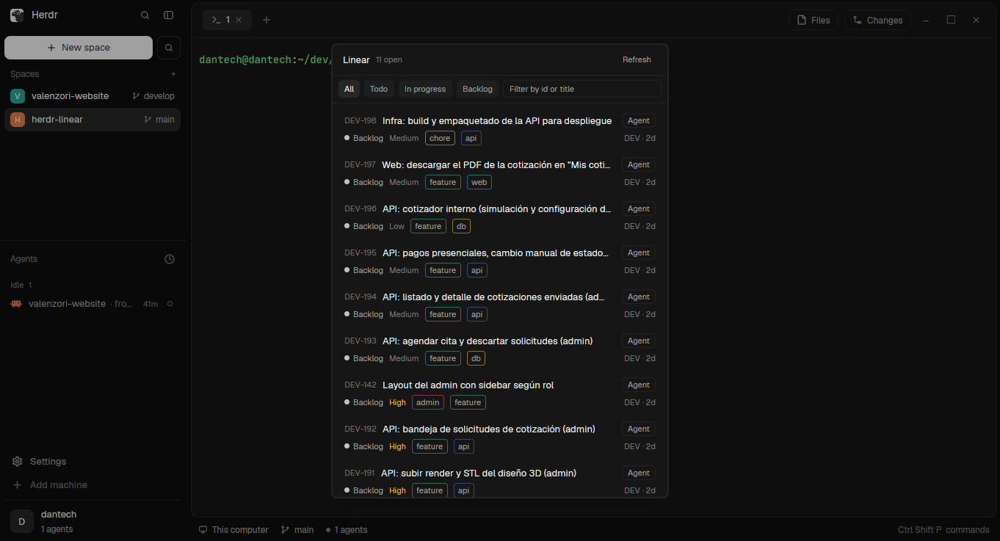

# Linear

Your open Linear issues in one panel, and an `Agent` button on each that starts a coding agent on it
in a fresh git worktree. Filter by state or text; click a row to open it in the browser. It opens
as a popup over the window (`ctrl-shift-y`), and fits a side panel of a cloned layout just as well.

## What you see

**The panel**: one column on the `background` color, radius 10, a 1px `border`, base type 13px.
Top to bottom:

- **Header**, 42px tall, 14px side padding, 8px gaps, a 1px `border` line under it: `Linear`
  semibold, `12 open` in 11px `dim`, and on the right a `Refresh` button (11px `muted`, 26px tall,
  8px side padding, radius 7, `hover` under the pointer) that reads `…` while a load runs.
- **Filter bar**, 38px tall, 8px side padding, 6px gaps, a 1px `border` line under it: four chips,
  `All`, `Todo`, `In progress`, `Backlog` (24px, 8px side padding, radius 6, 11px; the chosen one
  `selected`/`foreground`, the others `raised`/`muted`), then a text field filling the rest (24px,
  radius 6, placeholder `Filter by id or title`, its border `accent` while it holds text).
- **The list**, scrolling, 6px padding, rows 2px apart. Each row is two lines on a radius 7 card,
  10px side and 7px vertical padding, 3px between lines, `hover` under the pointer:
  - Line one: `ENG-123` at 11px in `accent`, an 8px gap, the title in `foreground` truncated to the
    width, and an `Agent` button: 20px tall, 7px side padding, radius 6, 11px `muted`, a 1px
    `border`; `raised` and `foreground` under the pointer.
  - Line two, 11px `dim`, 8px gaps: a 7px dot in the state's Linear color and the state name in
    `muted`; the priority label when set (`Urgent` in `ansi1`, `High` in `working`, others `dim`);
    up to two labels as pills (5px side padding, radius 4, a 1px border in the label's color at 53%
    alpha, text `muted`); on the right `ENG · 2d` (team key, time since the last update in `m`, `h`
    or `d`).
- In place of the list, at 8px padding: `Loading…` before the first load; `No open issues assigned
  to you`; `No issues match these filters`; or in `ansi1` `No Linear API key. Add it to
  ~/.config/herdr-app/linear.json or set LINEAR_API_KEY.`, `Invalid Linear API key`,
  `linear.json is not valid JSON`, or Linear's first error message.

As a popup it is 460×620 px, centered.

**The agent dialog** (480×660, `popover` background, 16px padding, sections 14px apart, each
titled in 11px `dim`). The title block and the footer stay; the sections between them scroll:

- `Start an agent on ENG-123` at 14px semibold, the issue title under it in `dim`, truncated.
- **Repository**: the folder the worktree is made from (and `· <machine>` for a remote space) in
  `muted`; `No folder: open a space in a git repo` in `ansi1` when there is none.
- **Branch**: a 30px input, radius 8, prefilled with Linear's suggested branch (`branchName`, e.g.
  `dan/eng-123-fix-login`), else `<identifier>-<first five title words>`.
- **Agent**: a wrapping row of 26px chips, radius 7, one per installed agent with its icon at 14px;
  the chosen one `selected`/`foreground`, the others `raised`/`muted`.
- **Model** (only for agents it knows): a filter input, then a 150px scrolling list. First row
  `Agent's default`, which reads `Use "<typed text>"` when the filter matches no model; then each
  model as `Label  ·  id`, up to 100. `Loading models…` while the CLI answers; its first error line
  in `ansi1` when it fails.
- **Reasoning**: chips of the levels the chosen model supports; `Agent's default` when none is
  chosen, `This model has no reasoning levels` when it has none.
- **Options**: one chip, `Ask it to use subagents` (`✓ Ask it to use subagents` when on).
- Footer: the error in 11px `ansi1` on the left, `Cancel` and a `Start agent` button in `solid`
  (`Starting…` while it works).

## How it behaves

- It doesn't show agent statuses: it lists Linear issues, not agents. Nothing animates.
- It loads the issues assigned to you that are not completed or canceled, up to 100, most recently
  updated first, on open, every 60 s and on `Refresh`. A load that finishes after a newer one
  started is dropped.
- The API key is `apiKey` in `~/.config/herdr-app/linear.json`, else `LINEAR_API_KEY` from the shell
  agents start in. It is sent only to `https://api.linear.app/graphql` as the `Authorization` header.
- Status chips filter by Linear's state types: `Todo` is `unstarted`, `In progress` is `started`,
  `Backlog` is `backlog` and `triage`. The text field filters the loaded issues by identifier and
  title as you type, case-insensitively. Filters reset when the panel reopens.
- A click on a row opens the issue on this computer, even for a space on a remote machine: `open`
  on macOS, `explorer` on Windows, `xdg-open` elsewhere. Only `https:` links are opened.
- `Agent` opens the dialog without opening the browser. The repository is the team's folder in
  `linear.json` `repos` (on this computer) when the issue's team is mapped, else the focused pane's
  folder (else the focused terminal's, else the shown space's folder) on that space's machine.
- In the dialog, Enter in the branch field starts. A branch that is empty, starts with `-` (git
  would read it as an option) or fails `git check-ref-format --branch` is refused with its reason.
  Start makes a worktree at
  `~/.herdr/worktrees/<repo>/<branch, slashes as dashes>` (the identifier when that leaves nothing
  but dots) on that machine (Herdr's own worktree
  path, so the spaces sidebar nests it and Herdr's worktree dialog can remove it). It branches from
  `origin/<default branch>` after a fetch (the default branch from `origin/HEAD`, else `main` or
  `master`), or from `HEAD` without an origin; an existing branch is checked out instead. Then
  `space.new` opens it with a tab named after the identifier, `argv` the agent's command plus its
  model and reasoning flags, and `task` one line: the identifier, title and URL, the description
  flattened to one line and cut at 600 characters, an ask to read the full issue if it has Linear
  access, to follow AGENTS.md/CLAUDE.md, run lint, typecheck and tests, push and open a PR that
  mentions the identifier, and not to merge or deploy. With the subagents option on, it also asks
  the agent to delegate exploration and verification to subagents. The new space is shown.
- The dialog remembers the last agent, model, reasoning and subagents choice (shared
  `linear-agent.last`) and caches each machine's model lists for an hour (shared
  `linear-agent.models`).
- Command: `linear.refresh` reloads. Bind it in `keys.json` or run `herdr-app do linear.refresh`.
  It reaches shown copies only.

## Built from

- `mods/linear/main.js`: one `View`, default export. `mod.json`:
  `{ "place": "none", "title": "Linear", "overlay": { "width": 460, "height": 620 } }`, so
  `mod.open {name: "linear"}` shows it as a popup and no layout docks it. `linear.svg`: a 24×24
  circle with a check, stroked `currentColor`, for a tab-bar button in a cloned layout.
- `mods/linear/linear.js`: pure helpers, no Herdr imports: `ISSUES_QUERY`, `STATUSES`,
  `parseConfig`, `parseIssues`, `linearError`, `filterIssues`, `ago`. The query:
  `viewer { assignedIssues(first: 100, orderBy: updatedAt, filter: { state: { type: { nin:
  ["completed", "canceled"] } } }) { nodes { id identifier title url branchName priority
  priorityLabel updatedAt description state { name type color } team { key name } labels { nodes {
  name color } } } } }`.
- `mods/linear/urls.js` (`safeUrl`: https only) and `mods/linear/open.js` (`openUrl`, by
  `window().platform`).
- `mods/linear-agent/main.js`: the dialog, a `View` opened with `openOverlay({ mod: "linear-agent",
  kind: "dialog", width: 480, height: 660, props: { issue, cwd, on } })`. `mod.json`:
  `{ "place": "none", "overlay": { "width": 480, "height": 660 } }`. Uses `knownAgents({ on })`
  (installed only), `exec` for git, `home`, `shared`/`setShared`, `run("space.new", { folder,
  machine, tab, argv, task })`. Adapted from the `issue-agent` mod in obrunogonzaga/herdr-mods
  (MIT).
- `mods/linear-agent/task.js`: pure `branchFor`, `folderName`, `worktreeFolder`, `branchProblem`,
  `taskFor`.
- `mods/linear-agent/agents.js`: one adapter per CLI, matched by the agent's key or program, copied
  from issue-agent:
  | Agent | Models from | Flags |
  | --- | --- | --- |
  | Claude Code | `fable`, `opus`, `sonnet`, `haiku` | `--model`, `--effort` (low…max) |
  | Codex | `codex debug models` | `-m`, `-c model_reasoning_effort=` |
  | OpenCode | `opencode models` | `--model` |
  | Cursor | `cursor-agent --list-models` | `--model` |
  | Pi | `pi --list-models` | `--model`, `--thinking` |
  | Gemini | none: type one | `--model` |
  Other agents start with their own `run` and no model choice.
- `keys.json`: `{ "global": { "ctrl-shift-y": "mod.open:linear" } }`.
- `herdr` functions: `spaces`, `panes`, `focused`, `exec`, `theme`, `home`, `appHome`,
  `readTextFile`, `nextCommand`, `openOverlay`, `closeOverlay`, `props`, `knownAgents`, `run`,
  `shared`, `setShared`, `window`; the global `fetch`.
- Reaches the network: `fetch` to `api.linear.app`, and `git fetch` when an agent starts. Runs
  programs: `sh` (to read `LINEAR_API_KEY`), `git`, the agents' CLIs (to list models), the system's
  opener. Starts agents with a task. Writes worktrees under `~/.herdr/worktrees`. Reads
  `~/.config/herdr-app/linear.json`.

## Watch out

- The API key is a secret. Keep `linear.json` out of the mod folder (updating the mod replaces it)
  and readable only by you: `chmod 600 ~/.config/herdr-app/linear.json`. Create a personal key in
  Linear under Settings → Security & access.
- `task` is typed into the agent as one line: a newline would send it early, so every text from
  Linear in it (title, description, URL) and the branch have control characters and runs of
  whitespace replaced by one space.
- The description is written by whoever filed the issue and goes into the agent's first message.
  Agents run with whatever permissions their own config gives them; the task tells them to push and
  open a PR.
- "Subagents" is only an instruction in the task. The mod starts one agent; whether it delegates
  is up to that agent.
- Mapped `repos` folders are on this computer; for a remote space, leave its team unmapped so the
  space's own folder and machine are used.
- Only the first 100 assigned issues load; the count is of what loaded.

## Done when

- `herdr-app check mods/linear` and `herdr-app check mods/linear-agent` pass.
- `node --test` passes (`linear.js`, `urls.js`, `task.js`).
- Without a key, `ctrl-shift-y` shows the `No Linear API key…` line; with a wrong one,
  `Invalid Linear API key`.
- With a valid key, the panel lists your open issues with their state, priority and labels, and the
  chips and the text field filter them.
- Clicking a row opens the issue in the browser.
- `Agent` on an issue in a space inside a git repo, Claude Code, `haiku`, `low`, Start: a new space
  opens on `~/.herdr/worktrees/<repo>/<branch>`, its tab is named after the identifier, and the task
  is the agent's first message.
